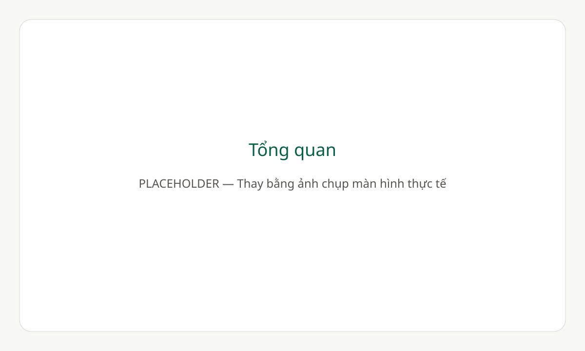
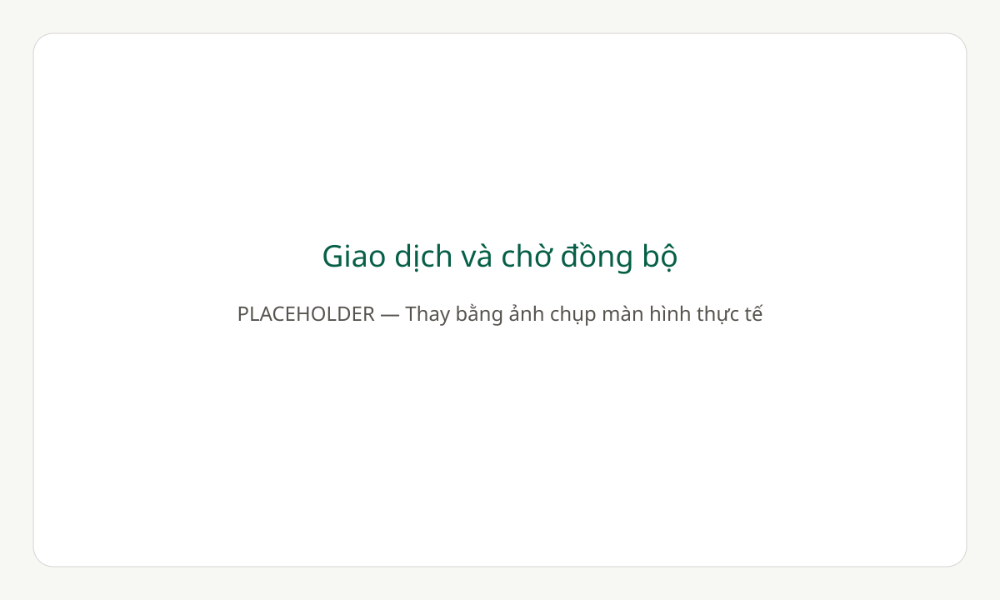
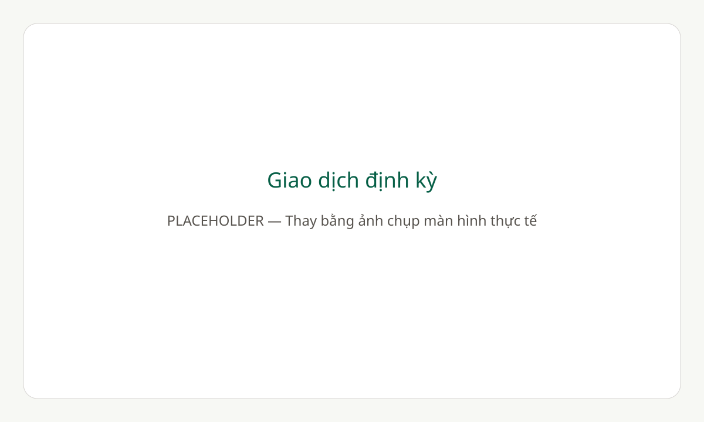

# Sổ chi tiêu cá nhân

Ứng dụng web tiếng Việt giúp ghi chép thu chi, xem thống kê theo tháng, theo dõi ngân sách và quản lý giao dịch định kỳ. Có chế độ demo và hàng đợi giao dịch ngoại tuyến. Giao diện hỗ trợ máy tính, điện thoại và cài đặt dưới dạng PWA.

**[Dùng thử ngay](https://so-chi-tieu-delta.vercel.app/demo)** · **[Mở ứng dụng](https://so-chi-tieu-delta.vercel.app)** · **[Mã nguồn](https://github.com/tuansangg24-a11y/quanlychitieucanhan)**

Có thể dùng thử ngay với 40 giao dịch mẫu bằng chế độ demo, không cần đăng ký. Dữ liệu demo chỉ lưu trên thiết bị; tài khoản Supabase quản lý dữ liệu riêng.

## Tính năng

- **Dùng thử:** dữ liệu mẫu tháng hiện tại và tháng trước, đủ ba mức ngân sách; thêm/sửa/xóa, lọc và CSV hoạt động cục bộ.
- **Ngoại tuyến:** hàng đợi IndexedDB theo tài khoản, UUID tránh tạo trùng, nhãn chờ đồng bộ và lỗi server được giữ lại để xử lý.
- **Định kỳ:** quản lý lịch hằng tuần/tháng/năm, tạo bù khi mở app, xử lý ngày cuối tháng, chống trùng nhiều thiết bị.
- **Tài khoản:** đăng ký, đăng nhập, đăng xuất và duy trì phiên qua Supabase Auth.
- **Tổng quan:** tổng thu, tổng chi, số dư trong tháng, so sánh với tháng trước; biểu đồ chi theo danh mục và thu chi theo ngày.
- **Giao dịch:** thêm, sửa, xóa khoản thu/chi; lọc theo ghi chú, tháng, danh mục, loại giao dịch và khoảng tiền; phân trang kết quả.
- **Danh mục:** tùy chỉnh tên, màu sắc, biểu tượng và loại thu/chi. Tài khoản mới được tạo sẵn 10 danh mục.
- **Ngân sách:** đặt hạn mức theo danh mục chi cho từng tháng; cảnh báo từ 80% và khi vượt hạn mức.
- **Xuất CSV:** xuất toàn bộ kết quả theo bộ lọc, hỗ trợ tiếng Việt và xử lý nội dung có thể trở thành công thức khi mở bằng Excel.
- **PWA:** cài lên màn hình chính, mở khung giao diện khi ngoại tuyến và thông báo khi có phiên bản mới.

Số tiền được nhập bằng VND nguyên dương, tối đa 15 chữ số. Số dư trên trang Tổng quan là thu trừ chi của tháng đang chọn.

## Ảnh chụp màn hình

Các hình dưới đây là **placeholder**, chưa phải ảnh chụp ứng dụng. Thay bằng PNG thực tế trong `docs/screenshots/` và cập nhật đường dẫn ảnh.







## Công nghệ

| Thành phần | Công nghệ |
| --- | --- |
| Giao diện | React 18, React Router 6, Tailwind CSS 3 |
| Công cụ phát triển | Vite 6, JavaScript |
| Xác thực và dữ liệu | Supabase Auth, PostgreSQL, Row Level Security |
| Biểu đồ và ngày tháng | Recharts 3, date-fns 4 |
| PWA | vite-plugin-pwa, Workbox |
| Triển khai | Vercel |

## Chạy trên máy

### 1. Cài đặt

Yêu cầu Node.js **22.12 trở lên** và pnpm. Dự án có `pnpm-lock.yaml` để cài đúng phiên bản phụ thuộc.

```sh
git clone https://github.com/tuansangg24-a11y/quanlychitieucanhan.git
cd quanlychitieucanhan
pnpm install --frozen-lockfile
```

### 2. Thiết lập Supabase

1. Tạo một project Supabase mới.
2. Trong SQL Editor, chạy toàn bộ [supabase/schema.sql](supabase/schema.sql) **một lần**, trước khi đăng ký tài khoản trong ứng dụng.
3. Bật đăng nhập Email trong phần cấu hình Authentication. Nên bật xác nhận email.
4. Đặt Site URL thành `http://localhost:5173` và thêm Redirect URL `http://localhost:5173/app`.

Nếu tài khoản đã được tạo trước khi cài schema, chạy thêm [supabase/backfill-default-categories.sql](supabase/backfill-default-categories.sql) để bổ sung danh mục cho tài khoản chưa có danh mục.

**Với project đã có các bảng của ứng dụng, giữ cấu hình và dữ liệu hiện tại; không chạy lại script tạo schema.**

### Migration cho giao dịch định kỳ

Áp dụng cho cả project mới vừa cài schema và project đang sử dụng. Sau khi project đã có schema, chạy [supabase/migrations/20261110_recurring_transactions.sql](supabase/migrations/20261110_recurring_transactions.sql) trong SQL Editor trước khi triển khai bản này. Không chạy lại hoặc sửa `schema.sql`. Migration chạy trong transaction, có thể chạy lại, không xóa dữ liệu hiện có; bổ sung bảng lịch, sổ kỳ đã tạo, cột đánh dấu giao dịch, RLS và hàm tạo bù. Yêu cầu PostgreSQL 15 trở lên (hỗ trợ `ON DELETE SET NULL (recurring_id)`).

Hàm `generate_recurring_transactions()` chạy với quyền tài khoản hiện tại, khóa lịch trong transaction và lưu biên nhận duy nhất cho từng kỳ. Xóa giao dịch đã sinh không tạo lại kỳ đó. Xóa lịch giữ các giao dịch cũ.

### 3. Cấu hình môi trường

Sao chép `.env.example` thành `.env.local` nếu chưa có tệp cấu hình. Trên PowerShell:

```powershell
Copy-Item .env.example .env.local
```

Điền URL và khóa anon công khai của project Supabase:

```dotenv
VITE_SUPABASE_URL=https://your-project.supabase.co
VITE_SUPABASE_ANON_KEY=your-public-anon-key
```

Các biến `VITE_*` được đưa vào mã chạy trên trình duyệt. Chỉ dùng khóa anon công khai; không dùng `service_role` hoặc khóa bí mật. Tệp `.env.local` đã được loại khỏi Git. Nếu cùng có `.env` và `.env.local`, Vite ưu tiên `.env.local`.

### 4. Khởi động

```sh
pnpm dev
```

Mở [http://localhost:5173](http://localhost:5173). Khởi động lại máy chủ phát triển sau khi đổi biến môi trường.

## Các lệnh thường dùng

| Lệnh | Chức năng |
| --- | --- |
| `pnpm dev` | Chạy môi trường phát triển |
| `pnpm test` | Chạy kiểm tra tự động |
| `pnpm build` | Tạo bản production trong `dist/` |
| `pnpm preview` | Xem thử bản production |

Preview mặc định chạy tại `http://localhost:4173`. Thêm `http://localhost:4173/app` vào Redirect URLs trong Supabase nếu kiểm tra luồng xác nhận email ở địa chỉ này.

Bộ kiểm tra hiện có 23 bài, bao gồm xử lý tiền VND, ngày/tháng, giao dịch, tìm kiếm, CSV, thống kê, ngưỡng ngân sách, dữ liệu demo, hàng đợi ngoại tuyến, thứ tự đồng bộ, lịch định kỳ và liên kết tài liệu. Kiểm tra tự động không thay thế việc kiểm tra đăng nhập, xác nhận email và phân quyền trên project Supabase thật.

## Cấu trúc dự án

```text
docs/screenshots/   Hình minh họa placeholder cho README
public/icons/       Biểu tượng ứng dụng và PWA
src/
  auth/             Quản lý phiên đăng nhập
  components/       Biểu mẫu, biểu đồ và thành phần giao diện
  data/             Trạng thái và tải dữ liệu
  lib/              API, demo, IndexedDB, đồng bộ, định kỳ, thống kê và CSV
  pages/            Tổng quan, giao dịch, danh mục, ngân sách và định kỳ
supabase/           Schema, policy và script bổ sung danh mục
  migrations/       Migration giao dịch định kỳ
tests/              Kiểm tra tự động
vercel.json         Cấu hình build và định tuyến SPA
vite.config.js      Cấu hình Vite và PWA
```

## Dữ liệu và phân quyền

Các bảng định kỳ `recurring_transactions` và `recurring_occurrences` cũng có RLS kiểm tra `auth.uid()`; lịch ràng buộc danh mục cùng chủ sở hữu và cùng loại.

Ba bảng chính là `categories`, `transactions` và `budgets`. Mỗi bản ghi gắn với người dùng; các policy Row Level Security kiểm tra quyền đọc và ghi theo `auth.uid()`.

Khóa ngoại ràng buộc danh mục và giao dịch cùng chủ sở hữu, cùng loại thu/chi. Ngân sách chỉ áp dụng cho danh mục chi. Danh mục đang được tham chiếu không thể bị xóa hoặc đổi loại; xóa ngân sách không xóa giao dịch.

Khi tự triển khai, cần kiểm tra bằng hai tài khoản độc lập để xác nhận mỗi tài khoản chỉ truy cập được dữ liệu của mình. Việc ẩn trang sau đăng nhập không thay thế phân quyền tại cơ sở dữ liệu.

## Triển khai

Dự án đã có `vercel.json` với thư mục đầu ra `dist` và rewrite về `index.html` cho các đường dẫn React Router.

Khi triển khai trên Vercel:

Trước khi triển khai phiên bản này, hoàn tất migration giao dịch định kỳ trên project Supabase đích theo hướng dẫn ở trên.

1. Import kho mã nguồn và chọn Node.js 22.
2. Cấu hình `VITE_SUPABASE_URL` và `VITE_SUPABASE_ANON_KEY` trong Environment Variables.
3. Dùng lệnh cài `pnpm install --frozen-lockfile`, lệnh build `pnpm run build`, output `dist`.
4. Trong Supabase, đặt Site URL theo tên miền triển khai và thêm Redirect URL tương ứng với đường dẫn `/app`.
5. Kiểm tra `/demo`, đăng nhập, xác nhận email, tải trực tiếp các trang `/app/*`, hàng đợi đồng bộ, giao dịch định kỳ và tài nguyên PWA.

## Cài ứng dụng lên điện thoại

Mở ứng dụng qua HTTPS. Trên Chrome/Edge/Android, dùng nút **Cài ứng dụng** khi trình duyệt hỗ trợ hoặc menu cài đặt của trình duyệt. Trên iPhone, mở bằng Safari rồi chọn **Chia sẻ → Thêm vào Màn hình chính**.

PWA chỉ hoạt động trong bản production. Service worker lưu tài nguyên giao diện, không cache dữ liệu Supabase. Giao dịch thêm/sửa/xóa được lưu vào hàng đợi IndexedDB và tự đồng bộ khi có mạng hoặc mở app. Dữ liệu đã tải được lưu theo tài khoản trên thiết bị, xóa khi đăng xuất.

Khi có phiên bản mới, ứng dụng hỏi **Cập nhật / Để sau**. Nên lưu hoặc đóng biểu mẫu trước khi cập nhật.

## Kiểm tra thủ công sau cập nhật

1. Mở `/demo` trên màn hình điện thoại; thử CRUD giao dịch/danh mục/ngân sách, lọc, CSV; tải lại để xác nhận lưu cục bộ. Bấm banner đăng ký để mở biểu mẫu.
2. Đăng nhập, tải dữ liệu, bật Offline trong DevTools. Thêm, sửa, xóa; kiểm tra số chờ và nhãn. Tải lại rồi bật mạng: hàng đợi phải chạy đúng thứ tự, không tạo trùng.
3. Dùng thiết bị thứ hai xóa danh mục trước khi đồng bộ một khoản mới: thiết bị đầu phải báo lỗi và giữ thao tác; sửa sang danh mục hợp lệ rồi thử lại. Kiểm tra đăng xuất xóa hàng đợi và tài khoản khác không thấy dữ liệu cũ.
4. Sau migration, tạo lịch ngày 31 và lịch năm ngày 29/2 trong quá khứ. Bấm tạo bù, mở lại và mở hai thiết bị đồng thời: mỗi kỳ chỉ có một giao dịch. Xóa một giao dịch rồi tạo bù lại: kỳ đã xóa không xuất hiện lại.
5. Kiểm tra tạm dừng/bật lại, sửa/xóa lịch và chỉnh từng giao dịch; kiểm tra RLS bằng hai tài khoản (cả bảng lịch, biên nhận và hàm tạo bù).

## Giới hạn hiện tại

- Chưa chuyển tự động dữ liệu demo sang tài khoản; có thể xuất CSV để giữ bản sao.
- Định kỳ chạy khi mở app có mạng hoặc bấm Tạo bù, không chạy nền khi app đóng. Bật lại lịch sẽ tạo bù thời gian tạm dừng. Thay đổi lịch giữ mốc lần tạo gần nhất và không sửa giao dịch cũ.
- Danh sách/tổng quan tải toàn bộ giao dịch của tài khoản để ghép hàng đợi; cần tối ưu phân trang/cache nếu có lượng dữ liệu lớn.
- Web Locks giúp tuần tự hóa đồng bộ giữa các tab trên trình duyệt hỗ trợ; trình duyệt cũ chỉ khóa trong từng tab, nên dùng một tab khi ghi ngoại tuyến.

- Ngoại tuyến chỉ hỗ trợ ghi giao dịch; cần tải danh mục trước. Danh mục và ngân sách cần mạng để thay đổi. Đăng xuất xóa dữ liệu ngoại tuyến, gồm các thao tác chưa đồng bộ.
- Đồng bộ theo thứ tự, dừng khi server từ chối. Xem lỗi và sửa giao dịch hoặc thử lại; thay đổi đồng thời dùng lần ghi thành công sau cùng.

- Dữ liệu chưa đồng bộ Realtime giữa các thiết bị; dùng Làm mới hoặc tải lại trang để nhận thay đổi.
- Xuất CSV đọc qua nhiều request, không phải ảnh chụp dữ liệu tại một thời điểm; tránh sửa đồng thời khi xuất tập dữ liệu lớn.
- Cài đặt PWA và xác nhận email cần được kiểm tra trên trình duyệt, thiết bị và tên miền thực tế.

## Xử lý lỗi thường gặp

| Hiện tượng | Cách kiểm tra |
| --- | --- |
| Thông báo chưa cấu hình Supabase | Kiểm tra hai biến môi trường và khởi động lại Vite; với bản triển khai, build lại sau khi đổi biến |
| Lỗi `PGRST205` | Kiểm tra đúng project URL và sự tồn tại của các bảng; chỉ cài schema khi project chưa có bảng |
| Liên kết xác nhận email chuyển sai địa chỉ | Kiểm tra Site URL và Redirect URLs trong Supabase |
| Tải trực tiếp trang con bị lỗi 404 | Kiểm tra hosting đã rewrite đường dẫn SPA về `index.html` |
| Không thấy nút cài PWA | Dùng HTTPS và bản production; kiểm tra tùy chọn cài trong menu trình duyệt |
